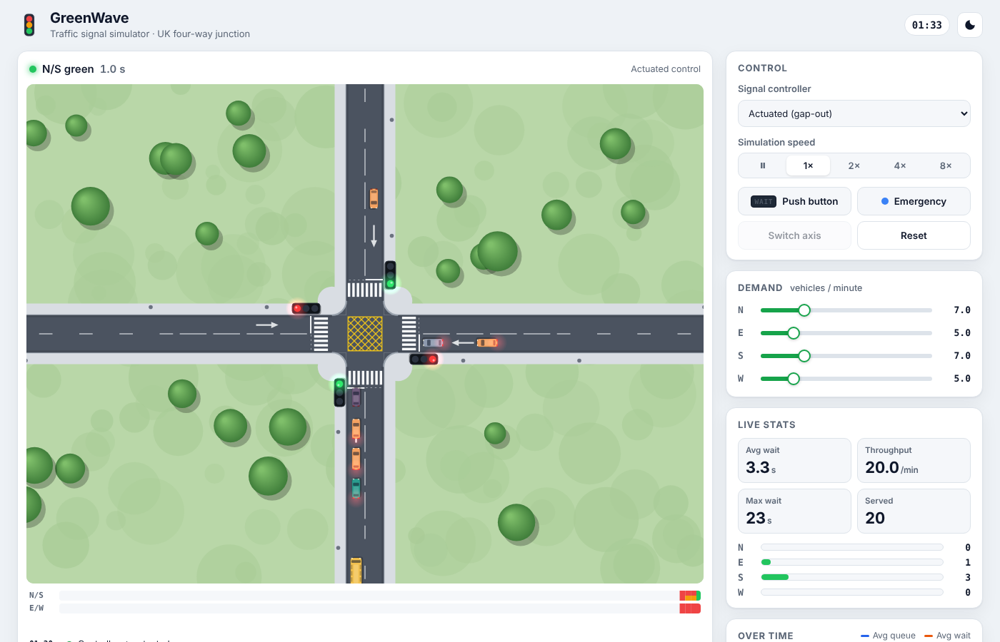
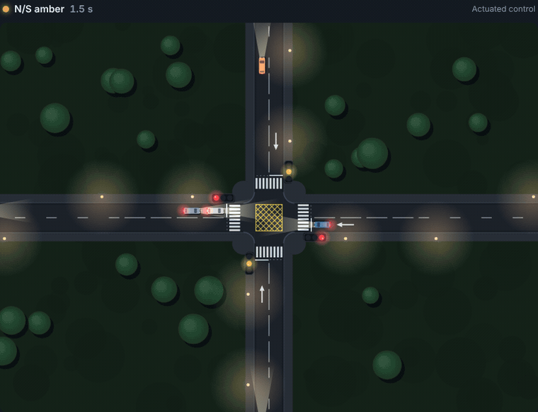
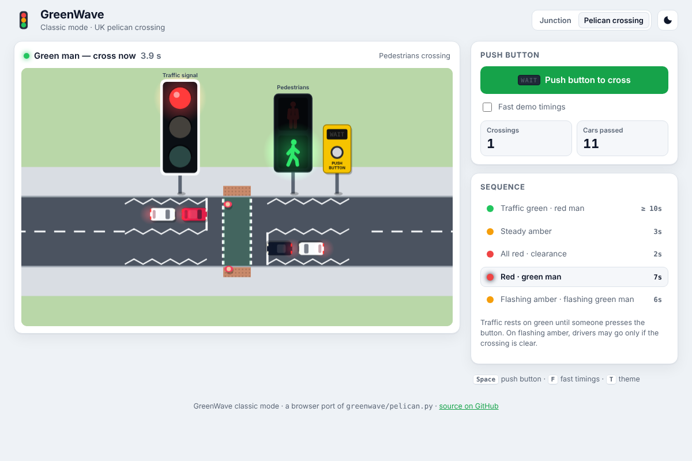
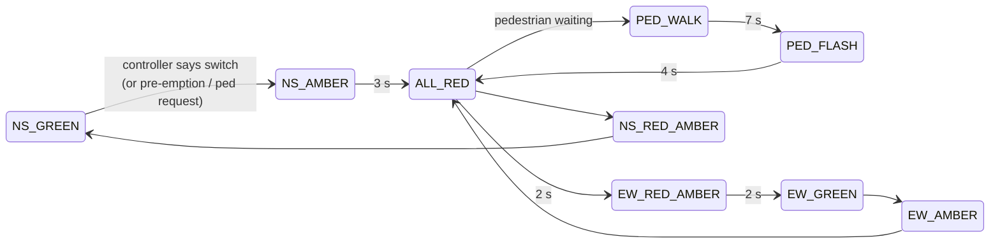
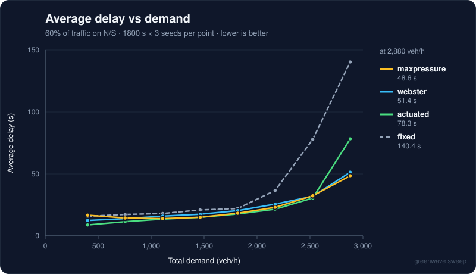

<div align="center">

# 🚦 GreenWave

**A traffic-signal simulator and playground.** It started as a single turtle-graphics traffic light and now covers a full junction.

[](https://github.com/22ishaq/TrafficLight/actions/workflows/ci.yml)


<picture>
  <source media="(prefers-color-scheme: dark)" srcset="docs/screenshot-dark.png">
  
</picture>

</div>

GreenWave has four parts, and all of them use the UK signal sequence (red → red + amber → green → amber):

| | What it is | Run it |
|---|---|---|
| 🌐 **Web playground** | An animated four-way junction in the browser (left-hand traffic). Vehicles follow each other using the Intelligent Driver Model. You can swap controllers while it runs, press the pedestrian button, send in an ambulance, and see live charts and a benchmark table. | `cd web && python3 -m http.server` → <http://localhost:8000> |
| 🐍 **Python research engine** | A fast, seeded queue simulation that runs hours of traffic in milliseconds. It compares Fixed-time, Webster, Actuated and Max-Pressure control. | `python -m greenwave benchmark` |
| 🖥️ **Terminal view** | An animated ANSI drawing of the junction in your terminal, with live signal heads, queues and metrics. | `python -m greenwave live` |
| 🕹️ **Classic mode** | The original turtle traffic light, rebuilt as a UK pelican crossing with a push-button, WAIT lamp, green man and flashing amber. It runs in turtle or in the browser. | `python -m greenwave classic` or `web/classic.html` |

No runtime dependencies. The web app needs no build step and the Python package uses only the standard library.

---

## Quick start

```bash
git clone https://github.com/22ishaq/TrafficLight.git && cd TrafficLight

# 1. Web playground (any static server works)
(cd web && python3 -m http.server 8000)    # open http://localhost:8000

# 2. Python engine + CLI
pip install -e ".[dev]"
greenwave benchmark --duration 3600 --seeds 5
greenwave webster --flows 432,432,288,288   # veh/h N,S,E,W -> optimum cycle 53.3 s
greenwave live --controller maxpressure     # animated junction in the terminal
greenwave sweep --out docs/sweep.svg        # delay-vs-demand chart (SVG)
greenwave classic                            # needs Tk (python3-tk on Linux)

# Tests
python -m pytest -q
(cd web && npm test)                         # node --test, no install needed
```

## Web playground

<p align="center"></p>

| Key | Action |
|---|---|
| `Space` | Pause / resume |
| `1` – `4` | Fixed · Actuated · Max-pressure · Manual controller |
| `P` | Press the pedestrian button (all-red "scramble" crossing) |
| `E` | Send in an emergency vehicle (signal pre-emption) |
| `M` | Manual switch (in Manual mode) |
| `R` | Reset |
| `T` | Toggle day / night |

What the playground does:

- **Vehicle dynamics**: each car follows the one ahead using the [Intelligent Driver Model](https://en.wikipedia.org/wiki/Intelligent_driver_model). A car stops for amber only if it can do so comfortably, and once it is past the stop line it always clears the junction.
- **Signal pre-emption**: an ambulance gets a green on its approach as soon as it is safe to give one. The other approach still goes through amber and all-red first.
- **Pedestrian scramble**: pressing the button brings in an all-red walk phase, followed by a flashing phase.
- **Seeded and deterministic**: the same seed always produces the same traffic, so controller comparisons are fair.
- **Benchmark**: one button runs every controller against identical traffic and highlights the winner.

To host the playground on **GitHub Pages**, go to *Settings → Pages* and set the source to **GitHub Actions**. Then run the *Deploy playground to Pages* workflow from the Actions tab. The `web/` folder is served as-is.

## Classic mode: the pelican crossing

The original project was a button-triggered traffic light, so classic mode is a faithful UK **pelican crossing**:
1. Traffic rests on green until someone presses the button.
2. After a minimum green, the light turns steady amber.
3. Next comes all-red clearance, then red for traffic while pedestrians get the green man.
4. Last, traffic sees flashing amber while pedestrians see a flashing green man. Drivers may go only if the crossing is clear.

The state machine (`greenwave/pelican.py`) is pure and unit-tested. It drives a turtle GUI and an identical browser port (`web/classic.html`), and the two produce the same results for the same button presses and timings.

<p align="center"></p>

## Signal control strategies

The models are explained in detail in [docs/HOW_IT_WORKS.md](docs/HOW_IT_WORKS.md), including the IDM equations, Webster's formula and the max-pressure rule.



| Controller | Idea | Good at |
|---|---|---|
| **Fixed-time** | Each axis gets the same green time every cycle. | Steady, balanced demand |
| **Webster** | A fixed-time plan whose cycle length C₀ = (1.5L + 5)/(1 − Y) and green splits are set by Webster's 1958 formula. | Predictable demand that is not balanced |
| **Actuated** | Minimum and maximum green times, with *gap-out* when no vehicle is approaching on the green axis. | Light or uneven traffic |
| **Max-Pressure** | Gives green to whichever axis has the larger queue. This is decentralised and throughput-optimal (Varaiya, 2013). | Heavy or shifting demand |

### Benchmark

This is the Python engine's output: 30 simulated minutes per run, averaged over 3 seeds. Every controller faces exactly the same arrivals.

```
$ greenwave benchmark --duration 1800 --seeds 3
GreenWave benchmark · 1800 s simulated × 3 seed(s)
demand  N 0.12  S 0.12  E 0.08  W 0.08 veh/s

   Controller   Avg delay  Max delay   Throughput  Avg queue  Delay vs fixed
─  ───────────  ─────────  ─────────  ───────────  ─────────  ──────────────
   fixed           19.2 s       62 s  1,455 veh/h    7.9 veh        baseline
   actuated        15.2 s       59 s  1,453 veh/h    6.3 veh         -20.6 %
★  maxpressure     14.6 s       68 s  1,454 veh/h    6.0 veh         -24.1 %
   webster         16.9 s       73 s  1,457 veh/h    6.9 veh         -12.0 %

★ maxpressure wins: 24 % less delay than fixed.
```

When demand is lopsided, fixed-time control falls apart and the adaptive controllers reduce average delay by about three quarters:

```
$ greenwave benchmark --duration 1800 --seeds 3 --demand 0.2,0.18,0.05,0.06
   Controller   Avg delay  Max delay   Throughput  Avg queue  Delay vs fixed
   fixed           61.3 s      321 s  1,689 veh/h   30.3 veh        baseline
   actuated        15.8 s       62 s  1,745 veh/h    7.8 veh         -74.3 %
★  maxpressure     14.8 s       89 s  1,752 veh/h    7.3 veh         -75.8 %
   webster         18.7 s      134 s  1,744 veh/h    9.2 veh         -69.5 %
```

### Delay vs demand

`greenwave sweep` raises total demand from light traffic up to near-saturation. Below about 2,000 veh/h every strategy performs about the same. Above that, fixed-time delay grows rapidly, and max-pressure, which was designed for heavy traffic, ends up best.

<p align="center"></p>

## Project layout

```
web/                 Browser playground (ES modules, no build)
  js/sim/            Pure simulation engine: IDM vehicles, signal phases, controllers, benchmark
  js/render.js       Canvas renderer (signal heads, crossings, night lighting)
  tests/             node --test suite
greenwave/           Python package (stdlib only)
  sim.py             Mesoscopic queue simulation of a 4-way junction
  controllers.py     FixedTime, Webster, Actuated, MaxPressure
  webster.py         Webster's optimal cycle & splits
  signals.py         UK traffic-light state machine
  pelican.py         Pelican crossing state machine
  classic.py         Turtle GUI (the original project, reborn)
  live.py            Animated ANSI terminal view
  report.py          Demand sweep + hand-drawn SVG chart
  cli.py             `greenwave` command line
tests/               pytest suite
legacy/              The original 2-file turtle script, kept for posterity
```

## History

GreenWave began as [`legacy/trafficlight.py`](legacy/trafficlight.py), a turtle script that drew three lamps and cycled them when a button was clicked. The classic mode keeps that idea and turns it into a correct pelican crossing state machine. That rewrite also fixes three bugs in the original: the click handler was never bound, the button's hit-box was the wrong size, and a ~11-day `ontimer` delay stood in for "stay green".

## License

[MIT](LICENSE) © 22ishaq
