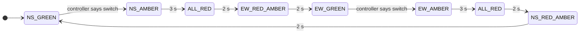
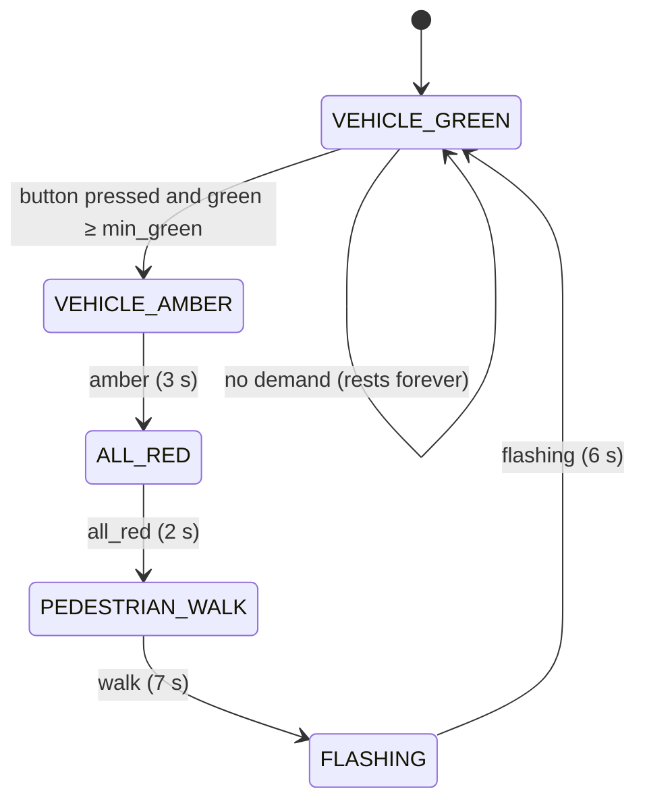

# How GreenWave works

GreenWave has two simulation engines and one set of signal ideas:

| Engine | Where | Model | Used for |
|---|---|---|---|
| **Web engine** | `web/js/sim/engine.js` | *Microscopic*: every vehicle has a position and speed (Intelligent Driver Model) | The interactive browser playground |
| **Python engine** | `greenwave/sim.py` | *Mesoscopic*: each approach is a queue at the stop line | Fast headless benchmarks (`python -m greenwave benchmark`) and the terminal live view |

Both model the same junction: four approaches (`N`, `E`, `S`, `W`, named for the direction traffic **comes from**), straight-ahead movements only, and two signal groups, or *axes*: `NS` and `EW`. Because nothing turns, the two directions on one axis never conflict, so an axis can always run green as a pair.

Every value quoted below is the code's default value.

---

## 1. UK signal sequence

### Aspects

A UK traffic signal shows four aspects in this order (`greenwave/signals.py`, `LightState`):

```
RED → RED_AMBER → GREEN → AMBER → RED …
```

| Aspect | Lamps lit | Meaning |
|---|---|---|
| `RED` | red | Stop |
| `RED_AMBER` | red + amber | Still stop. Green is coming |
| `GREEN` | green | Go if the way is clear |
| `AMBER` | amber | Stop, unless you cannot do so safely |

`TrafficLight` defaults to `red=30 s`, `red_amber=2 s`, `green=30 s`, `amber=3 s`. A duration of `None` holds that aspect until something advances it.

### Junction phases and the inter-green

At the junction, one axis loses green before the other gains it. The time between the two greens is the **inter-green**. Both engines use the same phases and timings:

| Phase | Duration | Python (`Timing`) | Web (`TIMINGS`) |
|---|---|---|---|
| `<A>_AMBER` | 3 s | `amber=3.0` | `AMBER: 3` |
| `ALL_RED` | 2 s | `all_red=2.0` | `ALL_RED: 2` |
| `<B>_RED_AMBER` | 2 s | `red_amber=2.0` | `RED_AMBER: 2` |
| `<B>_GREEN` | set by the controller | — | — |

So the **inter-green is 3 + 2 + 2 = 7 s**. Every switch of axis costs at least that much time in which no one moves.



The web engine can insert a pedestrian scramble after `ALL_RED` (see [section 5](#5-web-engine-pedestrians-and-emergency-vehicles)).

### Pelican crossing

`greenwave/pelican.py` (and the turtle GUI in `greenwave/classic.py`) models a UK **pelican** crossing (PEdestrian LIght CONtrolled). Traffic rests on green until someone presses the button.



| Phase | Vehicles see | Pedestrians see | WAIT lamp |
|---|---|---|---|
| `VEHICLE_GREEN` | green | red man | on if pressed |
| `VEHICLE_AMBER` | amber | red man | on |
| `ALL_RED` | red | red man | on |
| `PEDESTRIAN_WALK` | red | green man | **off** (demand served) |
| `FLASHING` | flashing amber | flashing green man | on if pressed again |

Rules, taken from the code:

- **Minimum green.** A press is honoured after the green has lasted `min_green` (10 s by default). If the green has already lasted that long, amber starts at once.
- **Pressing again changes nothing.** One demand is stored. Mashing the button does not restart or shorten the wait.
- **A press during the green man is ignored.** That person is already being served.
- **A press during flashing is queued.** WAIT lights again, and after the crossing ends the new green must still last `min_green`.
- **Flashing** blinks with `flash_period = 1.0 s`: on for the first half of each period, off for the second.
- **`PelicanTimings.fast()`** (the `--fast` flag) sets min_green 3 s, amber 1.5 s, all-red 1 s, walk 3 s, flashing 3 s, blink 0.5 s.

---

## 2. Web engine: Intelligent Driver Model

The web engine moves each vehicle along its own one-dimensional path. The path is 160 m to the stop line, then the 24 m junction box, then 160 m of exit road. The engine advances in sub-steps of at most **0.1 s**.

### The formula

Acceleration follows the Intelligent Driver Model (IDM) of Treiber, Hennecke and Helbing (2000):

$$
\dot v = a\left[1 - \left(\frac{v}{v_0}\right)^{\delta} - \left(\frac{s^*(v,\Delta v)}{s}\right)^{2}\right]
$$

$$
s^*(v,\Delta v) = s_0 + \max\!\left(0,\; vT + \frac{v\,\Delta v}{2\sqrt{ab}}\right)
$$

where $v$ is the vehicle's speed, $s$ the gap to the obstacle ahead, and $\Delta v$ the closing speed (own speed minus the leader's). Below, $x$ is the vehicle's position and $x_{\text{stop}} = 160$ m is the stop line.

### Parameters (`IDM` in `engine.js`)

| Symbol | Meaning | Value |
|---|---|---|
| $a$ | maximum acceleration | 1.6 m/s² |
| $b$ | comfortable deceleration | 2.0 m/s² |
| $s_0$ | minimum jam gap | 2.0 m |
| $T$ | safe time headway | 1.2 s |
| $\delta$ | acceleration exponent | 4 |
| $v_0$ | desired speed, car | 13.9 m/s (50 km/h) × uniform(0.9, 1.05) |
| $v_0$ | desired speed, bus (7 % of vehicles, 9–11 m long) | 12 m/s |
| $v_0$ | desired speed, emergency vehicle (6 m long) | 18 m/s |

Cars are 4.2–4.9 m long. Deceleration is capped at 9 m/s², a physical braking limit. Positions are updated with the trapezoid rule, and speed never goes below zero.

Two hard rules hold whatever the IDM says:

- A vehicle never ends up closer than 0.5 m to the rear of the vehicle ahead.
- A vehicle that must stop is clamped at 0.05 m before the stop line.

So vehicles never overlap, and the test suite checks this.

### A red light is a stationary obstacle

When a vehicle must stop, the engine adds a **virtual stationary leader** just past the stop line:

$$
s_{\text{light}} = (x_{\text{stop}} + 1) - x, \qquad \Delta v = v
$$

If that gap is smaller than the gap to the real leader, the vehicle follows the virtual one instead. The IDM then brakes smoothly towards it. Because of the jam gap $s_0 = 2$ m, the vehicle comes to rest about 1 m before the line.

A vehicle must stop when all of these hold:

- it has not yet crossed the stop line;
- it has not already committed to go through on amber;
- its light is `red`, `red_amber`, or `amber` with the dilemma-zone check below deciding "stop".

Once a vehicle is past the line it never stops for the signal.

### The amber dilemma zone

The first time a vehicle sees a given amber phase, it checks once whether it can stop in time. With distance to the line $d$ and speed $v$, the deceleration it would need is:

$$
b_{\text{needed}} = \frac{v^2}{2d}
$$

If $b_{\text{needed}} > 4\ \text{m/s}^2$ (`AMBER_STOP_DECEL`) **and** $d < 30$ m, stopping would be too harsh. The vehicle is marked `committed` and drives on through the amber. Otherwise it stops. The commitment lasts until its light next turns green.

### Arrivals

Arrivals are a Poisson process for each approach. Gaps between arrivals are drawn from an exponential distribution using a seeded `mulberry32` generator, so a seed always gives the same run.

An arrival only enters the road once the newest vehicle's rear has moved 6 m from the spawn point (`ENTRY_CLEARANCE`). Until then it waits off-road and counts as **blocked**.

A new vehicle enters at 0.85 × $v_0$, or slower if that is needed to be safe behind the vehicle ahead. Changing demand mid-run re-samples the next arrival from the current time, which is exact because Poisson arrivals are memoryless.

---

## 3. Python engine: mesoscopic queue model

`greenwave/sim.py` drops vehicle physics and treats each approach as a **point queue at the stop line**. That makes an hour of traffic take milliseconds, which is what the benchmarks need. The default step is `dt = 0.5 s`, and a seeded `random.Random(seed)` makes every run reproducible.

### Arrivals

Each approach is an independent Poisson process with rate $\lambda$ in vehicles per second. Gaps are drawn from `expovariate(λ)`. The default demand is `N=0.12, S=0.12, E=0.08, W=0.08` veh/s, which is 432 and 288 veh/h. Each arriving vehicle joins the back of its approach's queue, stamped with its arrival time.

### Discharge at saturation flow

While an axis is green, both of its queues discharge at the **saturation flow**. That is one vehicle per `saturation_headway = 2.0 s`, so $s = 0.5$ veh/s, or 1800 veh/h per lane.

Discharge works like this:

- **Start-up lost time.** Nothing moves in the first `startup_lost = 2.0 s` of each green while drivers react and pull away.
- **Credit.** Capacity builds up as credit at $s$ per second. Each whole unit of credit releases one queued vehicle.
- **Empty queues.** An empty queue can bank at most one vehicle's worth of credit, so a lone car arriving on green leaves almost at once.
- **No discharge** happens on amber, all-red or red+amber.

### Lost time per phase

Each change of axis wastes:

$$
\ell = \underbrace{3 + 2 + 2}_{\text{inter-green}} + \underbrace{2}_{\text{start-up}} = 9\ \text{s}
$$

This is `Timing.lost_time_per_phase`. With two phases, the lost time per cycle is $L = 18$ s.

### Delay

A vehicle's **delay** is the time it spent in the queue: from its arrival until the start of the step in which it is discharged. Vehicles still queued when the run ends count too, with their delay so far. This stops a controller from looking good by starving one approach.

---

## 4. Controllers

A controller is asked one question, only during a green phase: *switch to the other axis now?* The engine then runs the safe inter-green itself. Thresholds differ between the two engines, so both are listed.

### Fixed time (`fixed`)

Switch after **30 s** of green, whatever the traffic. Same in both engines.

### Webster (`webster`, Python only)

This is still a fixed-time plan, but the cycle length and green split come from Webster's (1958) delay-minimising formula, computed once from the expected demand when the run starts.

$$
C_0 = \frac{1.5L + 5}{1 - Y}, \qquad Y = \sum_i y_i, \qquad y_i = \frac{q_i}{s}
$$

- $q_i$ is the flow on the busier approach of phase $i$ (the critical flow).
- $s$ is the saturation flow.
- $L$ is the total lost time per cycle.

The cycle is clamped to the range [30 s, 120 s]. The effective green, $C_0 - L$, is shared between phases in proportion to $y_i$. If $Y \ge 1$ the junction is oversaturated: no cycle can serve the demand, so the plan uses the 120 s maximum.

**Worked example, using the default demand:**

| Step | Value |
|---|---|
| Saturation flow $s$ | 1 / 2.0 s = 0.5 veh/s |
| $y_{NS} = \max(0.12, 0.12) / 0.5$ | 0.24 |
| $y_{EW} = \max(0.08, 0.08) / 0.5$ | 0.16 |
| $Y$ | 0.40 |
| $L = 2 \times 9$ s | 18 s |
| $C_0 = (1.5 \times 18 + 5) / (1 - 0.40) = 32 / 0.6$ | **53.3 s** |
| Effective green $C_0 - L$ | 35.3 s |
| Effective green NS: $35.3 \times 0.24/0.40$ | 21.2 s |
| Effective green EW: $35.3 \times 0.16/0.40$ | 14.1 s |
| Displayed green, adding back 2 s start-up loss | **NS 23.2 s, EW 16.1 s** |

The code produces exactly these numbers: `webster_plan(...)` and `Webster.greens`.

### Vehicle actuated (`actuated`)

Green is extended while traffic keeps coming, and **gaps out** when it stops. Once minimum green has passed:

- If **no one waits on the other axis**, rest on green.
- If the green has reached **max green**, switch (max-out).
- Otherwise, if no vehicle has been detected on the green axis for **3 s**, switch (gap-out).

| | Python | Web |
|---|---|---|
| min green | 8 s | 8 s |
| max green | 45 s | 45 s |
| gap | 3 s | 3 s |
| what counts as a detection | a new arrival on the green axis, *and* the green-axis queue must be empty | any vehicle within **30 m** upstream of the stop line on the green axis (a detector loop) |
| "other axis waiting" | queue > 0 | any vehicle still to cross the stop line, including blocked arrivals |

### Max pressure (`maxpressure`)

This is the max-pressure, or back-pressure, idea from Varaiya (2013): give green to the movement with the most waiting traffic. With one junction and two axes, that means switching when the red axis's queue is clearly larger than the green axis's. The switching rule includes **hysteresis**, so the signal doesn't flap, since every switch costs 9 s of lost time.

Both engines follow the same steps after minimum green:

1. If the other axis has no demand, rest on green.
2. If max green is reached, switch.
3. Otherwise, switch when the other axis's pressure is clearly higher than the green axis's (the exact rule differs, see below).

| | Python | Web |
|---|---|---|
| min green | 10 s | 8 s |
| max green | 60 s | 60 s |
| switch rule | $q_{\text{red}} > 3\,q_{\text{green}} + 3$ (`ratio=3`, `threshold=3`) | $p_{\text{red}} - p_{\text{green}} > 2$ |
| pressure of an axis | queued vehicles | blocked arrivals + queued vehicles (speed < 1 m/s, before the line) + **0.5 ×** moving vehicles within 60 m of the line |
| extra rule | — | switch at once if the green axis has no demand left |

### Manual (`manual`, web only)

Switches only when you press **Switch**, once the green has lasted at least 2 s.

---

## 5. Web engine: pedestrians and emergency vehicles

The engine applies these on top of whatever the controller decides.

### Pedestrian scramble

Pressing the pedestrian button (`requestPedestrian()`) stores one request. A press during the walk phase is ignored. The request is served as an **all-red scramble**: every vehicle approach is red while pedestrians use all four crosswalks.

1. During a green, once the green has lasted **6 s** (`MIN_GREEN_PED`), the request ends the green. Amber follows.
2. After `ALL_RED` (2 s), the engine runs `PED_WALK` instead of red+amber.
3. `PED_WALK` lasts **7 s**: green man.
4. `PED_FLASH` lasts **4 s**: flashing, do not start to cross.
5. A shorter `ALL_RED` of **1 s** clears the crossing.
6. Red+amber and green go to the axis that was due next.

Each crosswalk gets 0–3 walkers with random start delays of 0–3 s. These are drawn for the picture only and do not affect vehicles. Walkers who haven't stepped off the kerb when the walk phase ends stay on the kerb.

### Emergency pre-emption

`spawnEmergency(approach)` adds an emergency vehicle. While it has not yet crossed the stop line, its axis is the **pre-empt axis**, and the engine overrides the controller safely:

| Current phase | What pre-emption does |
|---|---|
| Green on the **pre-empt axis** | Holds green. The controller and pedestrian requests are ignored. |
| Green on the **other axis** | Switches to amber after at least **2 s** of green (`MIN_GREEN_PREEMPT`). |
| `ALL_RED` | Sets the next green to the pre-empt axis. No pedestrian walk is started. |
| Red+amber on the **wrong axis** | Drops back to a 1 s all-red. Red+amber still means stop, so this is safe. Then serves the pre-empt axis. |
| `PED_WALK` | Ends the walk early and goes straight to `PED_FLASH`. The full 4 s flashing clearance is kept. |

The emergency vehicle itself is an ordinary IDM vehicle with $v_0 = 18$ m/s. It still queues behind traffic and still obeys the lights. Pre-emption clears its path; it does not let the vehicle ignore the rules.

---

## 6. Metrics glossary

### Python engine (`greenwave.metrics.Metrics`)

| Metric | Definition |
|---|---|
| `avg_delay` | Mean queueing delay (s) over served vehicles plus vehicles still queued (with delay so far) |
| `max_delay` | Worst single-vehicle delay (s), including vehicles still queued |
| `throughput_per_hour` | Vehicles served ÷ simulated time × 3600 |
| `avg_queue` | Time-averaged number of vehicles queued, **summed over all four approaches** |
| `max_queue` | Longest queue seen on any single approach |
| `served` / `spawned` / `remaining` | Vehicles discharged / arrived / still queued at the end (`spawned = served + remaining`) |
| `switches` | Number of times green moved to the other axis |
| `delay_by_approach` | Mean delay per approach (`N`, `E`, `S`, `W`) |

`benchmark()` runs every controller on the **same seeds** (default 1–5) and averages the results. `max_*` fields keep the worst case.

### Web engine (`sim.stats`, `sim.summary()`)

| Metric | Definition |
|---|---|
| `waitTime` (per vehicle) | Seconds spent below 0.5 m/s before the stop line |
| `avgWait` | Mean `waitTime`. In `stats` it covers served vehicles only. In `summary()` (benchmarks) it also includes vehicles still before the line |
| `maxWait` | Worst `waitTime`, counting vehicles still waiting |
| `queue[A]` | Vehicles on approach A before the line moving below 1 m/s, plus blocked arrivals |
| `avgQueue` | Mean queue **per approach**. The four-approach total ÷ 4 (time-averaged in `summary()`) |
| `throughputPerMin` | Vehicles that left the map in the last 60 s |
| `throughputPerHour` | Vehicles served ÷ simulated time × 3600 |
| `blocked` | Arrivals waiting off-road because the lane entry is full |
| `emergencyServed`, `pedestrianPhases` | Emergency vehicles that left the map; scramble phases run |
| `history` | A sample every 5 s (last 360 kept) of average queue, throughput per minute, average wait, queues and phase |

The web `runBenchmark()` runs `fixed`, `actuated` and `maxpressure` for 900 s on seeds 1–3 each and averages `summary()`.

> Note: `avgQueue` means different things in the two engines. Python sums all four approaches; the web engine averages per approach. Don't compare them directly.

---

## 7. References

- M. Treiber, A. Hennecke and D. Helbing (2000). *Congested traffic states in empirical observations and microscopic simulations.* Physical Review E 62(2), 1805–1824. The Intelligent Driver Model.
- F. V. Webster (1958). *Traffic Signal Settings.* Road Research Technical Paper No. 39, Road Research Laboratory, HMSO, London. The optimum cycle formula.
- P. Varaiya (2013). *Max pressure control of a network of signalized intersections.* Transportation Research Part C 36, 177–195.
- Department for Transport (2019). *Traffic Signs Manual, Chapter 6: Traffic Control.* TSO, London. UK signal aspects, sequences and crossing operation.
